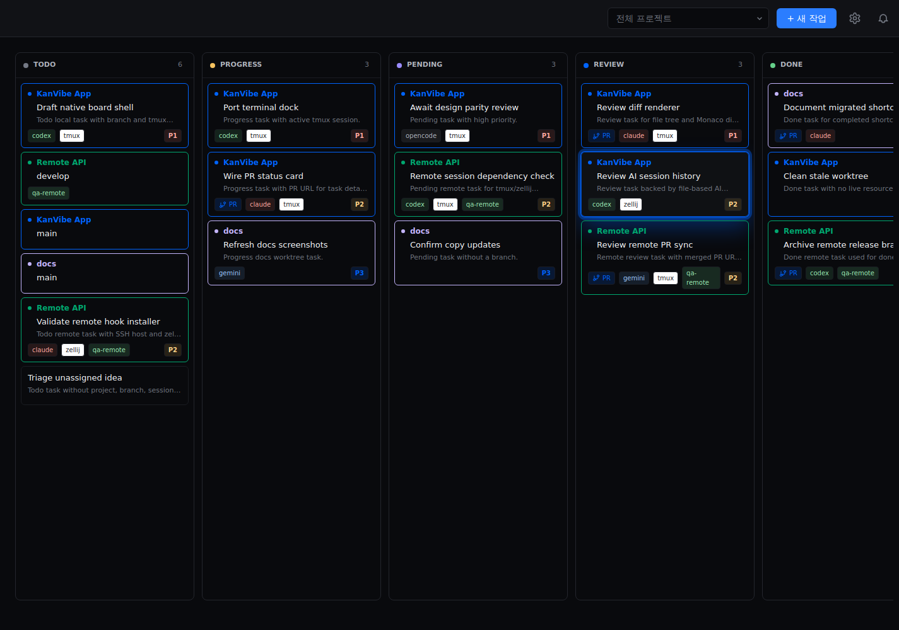
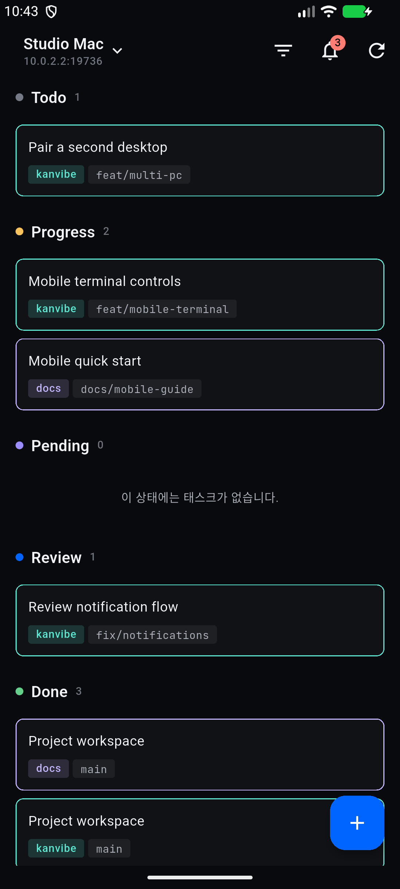
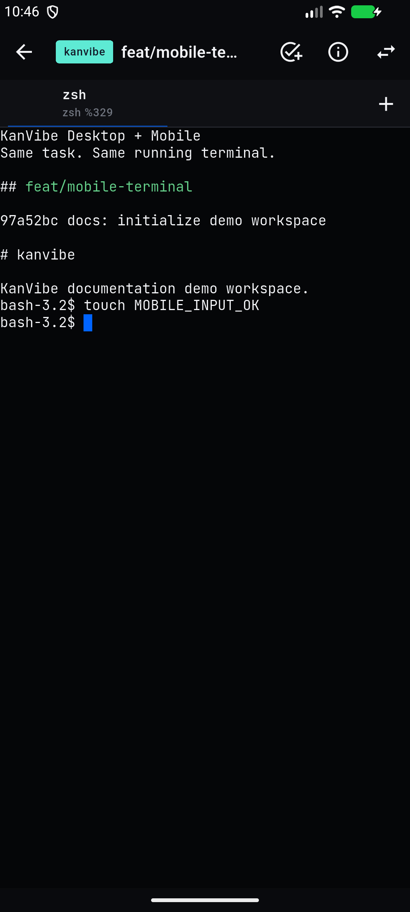
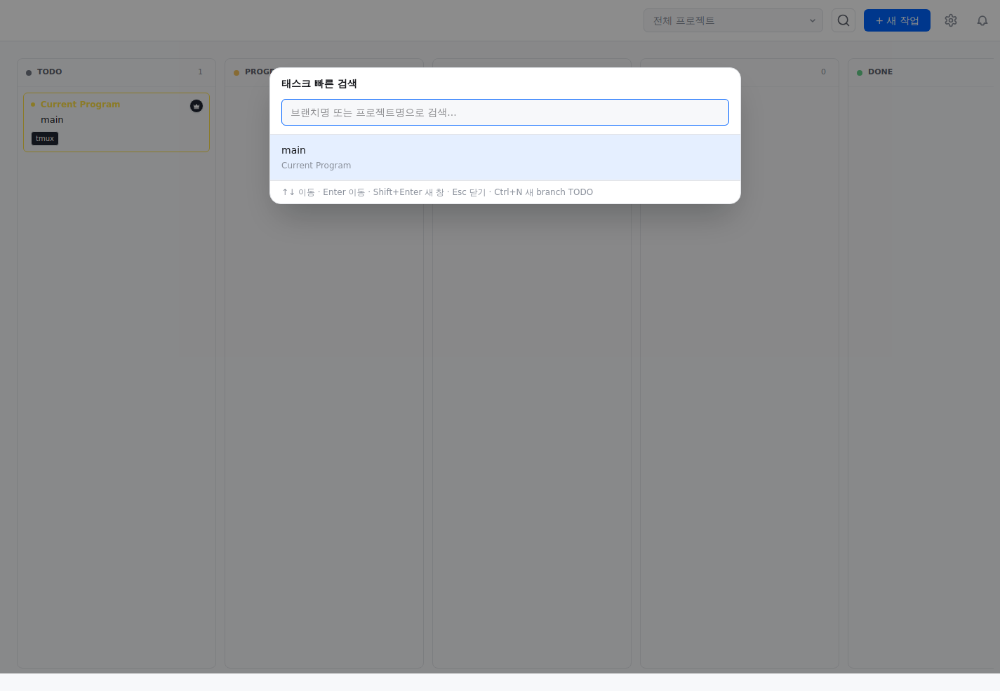
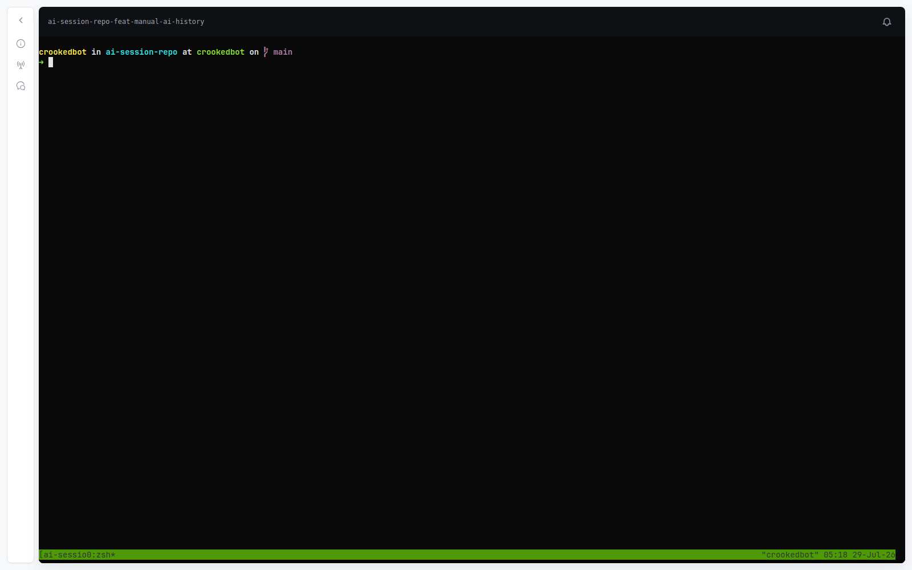
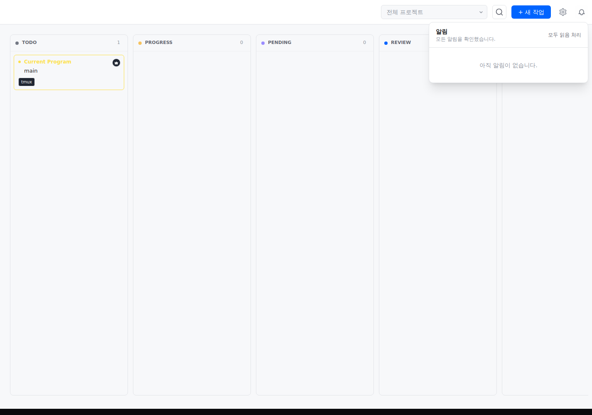
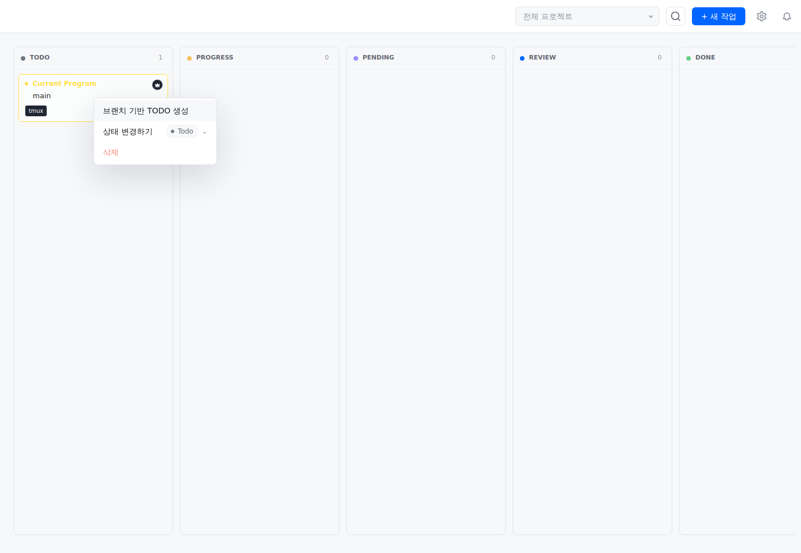

<div align="center">

<picture>
  <source media="(prefers-color-scheme: dark)" srcset="../public/branding/kanvibe-logo-light.png">
  
</picture>

# KanVibe

**AI 코딩 작업을 한눈에. 휴대폰에서도 이어서.**

KanVibe는 AI 코딩 에이전트를 위한 키보드 중심 macOS 칸반 워크스페이스입니다. Claude Code, Codex, Gemini CLI, OpenCode 작업을 브랜치·git worktree·터미널이 연결된 태스크로 관리하세요. 칸반 보드에서 진행 상황을 파악하고, 휴대폰이나 태블릿에서 PC의 실행 중인 터미널을 열어 출력을 읽고 다음 명령을 입력할 수 있습니다.

**[Desktop 설치](https://kanvibe.rookedsysc.com/ko/installation)** → [휴대폰 연결](https://kanvibe.rookedsysc.com/ko/mobile) · [문서](https://kanvibe.rookedsysc.com/ko)

[EN](../README.md) | [ZH](./README.zh.md)

</div>

<table>
  <tr>
    <td width="77%" valign="top">
      
      <br><strong>Desktop: 작업과 진행 상태를 한눈에</strong>
    </td>
    <td width="23%" valign="top">
      
      <br><strong>Mobile: 휴대폰에서도 같은 보드 확인</strong>
    </td>
  </tr>
</table>

<p align="center">
  <a href="https://www.youtube.com/watch?v=8JTrvd3T_Z0">
    
  </a>
  <br><strong>YouTube에서 Desktop 데모 보기</strong>
</p>

## 시작하기

macOS Desktop 앱은 KanVibe Homebrew tap에서 설치합니다.

```bash
brew install --cask rookedsysc/kanvibe/kanvibe
open -a KanVibe
```

**Mobile (iOS / Android):** Flutter 앱을 소스에서 빌드한 뒤 **Desktop 설정 → 모바일 연결**에서 PC 주소·포트·일회용 코드로 연결합니다. PC의 KanVibe가 실행 중이어야 하며, 휴대폰에서 로컬 네트워크나 Tailscale 등을 통해 해당 주소에 접속할 수 있어야 합니다. Mobile은 초기 미리보기이며 화면은 한국어입니다. [연결·사용·알림 안내](https://kanvibe.rookedsysc.com/ko/mobile).

**Mobile 터미널 호환성:** `herdr`, `tmux`, `zellij`, `terminal` 세션을 모두 지원합니다. Herdr 세션은 원본 격자를 유지한 채 스크롤로 읽습니다.

## PC에서 시작하고, 휴대폰에서 이어가기

1. **확인이 필요한 작업을 찾습니다.** 에이전트 hooks가 진행·입력 대기·검토 상태를 보드에 반영합니다.
2. **작업 맥락을 유지합니다.** 태스크의 브랜치·worktree·터미널·채팅 기록·PR 액션을 함께 열고 단축키로 작업 사이를 이동합니다.
3. **Mobile에서 이어갑니다.** 보드와 실행 중인 터미널을 확인하고 후속 명령을 입력하거나, 연결한 다른 PC로 전환합니다.

<p align="center">
  
  <br><strong>같은 태스크 터미널에서 출력 확인과 명령 입력</strong>
</p>

<details>
<summary>키보드 워크플로우와 스크린샷</summary>

## 주요 워크플로우

### 1. 빠른 태스크 검색

어디서든 태스크 검색을 열고 프로젝트나 브랜치명으로 필터링한 뒤, 보드로 돌아가지 않고 바로 태스크 워크스페이스로 이동합니다.



### 2. 태스크 상세 단축키

태스크 상세 페이지의 번호형 dock 단축키로, 키 입력이 임베디드 터미널에 도달하기 전에 태스크 메타데이터, hook 상태, AI 채팅, PR 액션을 열 수 있습니다.



### 3. 프로젝트 필터

관심 있는 활성 프로젝트만 보이도록 보드를 좁히고, 키보드 네비게이션으로 저장소 사이를 빠르게 전환합니다.


### 4. 알림

알림 패널을 열어 AI 에이전트 상태 변경, 백그라운드 동기화 결과, 태스크 이벤트를 확인하고 관련 태스크로 이동합니다.



### 5. 빠른 태스크 액션

검색 결과에서 하이라이트된 태스크를 기준으로 후속 브랜치 TODO를 바로 만들고, 다음 작업에 필요한 프로젝트와 브랜치 컨텍스트를 유지합니다.



### 6. Vim 스타일 보드 조작

**설정 → 키보드**에서 Vim 스타일 보드 조작을 켠 뒤 `h/j/k/l`로 태스크 카드를 이동하고, `/`로 보이는 태스크 텍스트를 검색하며, `n`으로 새 태스크 모달을 열고, `:move progress`로 상태를 이동하고, 포커스된 태스크를 `dd`로 삭제합니다.

<video src="./images/readme/kanvibe-vim-controls.mp4" poster="./images/readme/kanvibe-vim-controls.png" controls muted playsinline width="100%"></video>

[Vim 조작 데모 영상 열기](./images/readme/kanvibe-vim-controls.mp4)

</details>

## 사전 요구사항

| 의존성 | 버전 | 필수 | 설치 |
|--------|------|------|------|
| [git](https://git-scm.com/) | 최신 | Yes | `brew install git` |
| [tmux](https://github.com/tmux/tmux) | 최신 | Mobile 터미널용 (또는 Herdr, zellij) | `brew install tmux` |
| [gh](https://cli.github.com/) | 최신 | Yes | `brew install gh` (`gh auth login` 필요) |
| [zellij](https://github.com/zellij-org/zellij) | 최신 | Mobile 터미널용 (또는 Herdr, tmux) | `brew install zellij` |
| [Herdr](https://herdr.dev/tui/docs/) | 0.9.5 검증 | 기본 백엔드 | 앱 내 설치 안내 |

### 업데이트 또는 제거

```bash
brew update
brew upgrade --cask kanvibe
```

```bash
brew uninstall --cask kanvibe
brew untap rookedsysc/kanvibe
```

---

## 사용 흐름

### 1. 프로젝트 등록

메인 보드 상단에서 프로젝트 필터와 **+ 새 작업** 사이의 **돋보기 디렉터리 스캔 버튼**을 눌러 프로젝트 등록 dialog를 엽니다. Dialog에서 로컬/원격 git 저장소 경로를 선택하고 **스캔 및 등록**을 누르면 KanVibe가 저장소를 등록하고 기존 worktree 브랜치를 감지하며 지원 에이전트 hook을 설치합니다.

프로젝트 관리를 중단하려면 등록 dialog 하단의 등록된 프로젝트 목록에서 삭제하세요. 이 동작은 SQLite의 프로젝트와 연결된 KanVibe 태스크 레코드만 제거하며, 디스크의 git 브랜치, worktree, 파일은 보존합니다.

### 2. 태스크 생성

칸반 보드에서 TODO 태스크를 추가합니다. 브랜치명으로 태스크를 생성하면 KanVibe가 자동으로:
- 해당 브랜치의 **git worktree**를 생성합니다
- 세션용 **Herdr tab**, **tmux window** 또는 **zellij tab**을 생성합니다
- 터미널 세션을 태스크에 연결합니다

### 3. 칸반 보드에서 작업

태스크는 5단계 상태로 관리됩니다: **TODO** → **PROGRESS** → **PENDING** → **REVIEW** → **DONE**

드래그 앤 드롭으로 상태를 변경하거나 [AI 에이전트 Hooks](#ai-에이전트-hooks---자동-상태-추적)가 자동으로 상태를 전환하게 할 수 있습니다. 태스크를 **DONE**으로 이동하면 브랜치·worktree·터미널 세션을 보존합니다. 태스크를 삭제할 때 리소스를 정리하며, 프로젝트 루트 브랜치는 보호합니다.

### 4. Pane 레이아웃 선택

각 태스크의 터미널 페이지에서 다양한 pane 레이아웃을 지원합니다:

| 레이아웃 | 설명 |
|----------|------|
| **Single** | 전체 화면 단일 pane |
| **Horizontal 2** | 좌우 2분할 |
| **Vertical 2** | 상하 2분할 |
| **Left + Right TB** | 왼쪽 pane + 오른쪽 상하 분할 |
| **Left TB + Right** | 왼쪽 상하 분할 + 오른쪽 pane |
| **Quad** | 4등분 |

각 pane에 커스텀 명령어를 설정할 수 있습니다(예: `vim`, `htop`, `lazygit`, 테스트 러너 등). 레이아웃은 설정 다이얼로그에서 전역 또는 프로젝트별로 설정할 수 있습니다.

---

## 기능

### 실시간 칸반 보드
- 5단계 태스크 관리(TODO / PROGRESS / PENDING / REVIEW / DONE)
- 프로젝트 색상, 우선순위 표시, PR 배지, 세션 라벨을 포함한 드래그 앤 드롭 태스크 정렬
- 보이는 프로젝트와 태스크 텍스트를 키보드로 검색할 수 있는 다중 프로젝트 필터링
- 장기 프로젝트를 위한 Done 컬럼 페이지네이션
- 브라우저와 데스크톱 창 전체에 WebSocket 기반 실시간 업데이트

### 브랜치 기반 태스크 워크스페이스
- git worktree와 터미널 세션을 자동으로 준비하는 브랜치 TODO 생성
- 보드 toolbar의 돋보기 스캔 dialog로 저장소를 등록하고 기존 worktree 브랜치를 TODO 태스크로 감지
- 각 태스크를 전용 터미널 워크스페이스로 열고, 사이드 dock에서 태스크 메타데이터, hook 컨트롤, 채팅, PR 액션 사용
- DONE 이동 시 리소스 보존, 태스크 삭제 시 브랜치·worktree·터미널 세션 정리. 프로젝트 루트 브랜치는 보호
- 기존 git 브랜치, worktree, 디스크 파일을 건드리지 않고 디렉터리 스캔 dialog에서 프로젝트 삭제

### 터미널 세션 (Herdr / tmux / zellij)
- **Herdr**, **tmux**, **zellij** 모두 터미널 멀티플렉서로 지원
- xterm.js와 WebSocket 기반 브라우저 터미널 스트리밍
- `~/.ssh/config`를 읽는 SSH 원격 터미널 지원
- 비대화형 원격 SSH 명령은 `~/.kanvibe` 아래의 앱 전용 ControlMaster 소켓 풀을 재사용하며 host별 동시성을 사용 가능한 CPU 코어 수의 4배까지 제한합니다
- 원격 터미널 attach는 SSH에서 Herdr/tmux/zellij를 직접 실행하며, 로컬 `DISPLAY`, 원격 `X11Forwarding`, `xauth`가 준비된 경우에만 trusted X11 forwarding(`ssh -Y`)을 요청합니다
- Nerd Font 렌더링 지원

- 저장된 유효한 설정이 없으면 Herdr가 기본값이며, 기존 tmux·zellij·terminal 선택은 유지합니다. 새 Herdr 태스크는 호스트별 영구 `kanvibe` 서버를 공유하며, 태스크마다 만든 workspace가 Spaces에 함께 표시됩니다. 처음 열 때 설정한 6가지 pane 레이아웃과 시작 명령을 적용하고, 다시 열면 실행 중인 셸을 이어 씁니다. 기존 독립 세션은 명시적으로 교체할 때까지 유지합니다.
- Herdr 탭은 생성·전환·이름 변경·닫기와 workspace 안에서의 드래그 순서 변경을 지원합니다. Space와 탭 선택은 해당 태스크 창에만 적용됩니다. KanVibe를 닫아도 마지막 탭은 유지하며, 공유 태스크를 삭제하면 해당 workspace만 닫아 다른 태스크의 작업은 계속 실행됩니다. workspace ID 연결 정보를 Herdr 세션 디렉터리에 저장하므로 Space 이름을 바꿔도 다시 연결됩니다. Herdr의 첫 실행 설정과 개인 설정은 Herdr가 관리합니다.
- 태스크 생성·브랜치 생성·터미널 연결에서 `herdr`를 선택하면 로컬 또는 선택한 SSH 호스트의 설치 여부를 확인합니다. Herdr가 없으면 설치 안내를 승인해 해당 호스트에서 [공식 설치 프로그램](https://herdr.dev/tui/docs/install/)을 실행할 수 있습니다. `~/.local/bin`에 설치하며 셸 시작 파일은 바꾸지 않습니다. 취소하면 태스크는 변경되지 않습니다. 설치에 실패하면 오류를 확인하고 네트워크 연결과 설치 경로의 쓰기 권한을 점검한 뒤 다시 시도합니다.

### 키보드 중심 조작
- 어디서든 브랜치명이나 프로젝트명으로 빠른 태스크 검색 열기
- 보드를 떠나지 않고 프로젝트 필터링, 알림 확인, 태스크 액션 실행
- 키 입력이 터미널에 도달하기 전에 번호형 상세 단축키로 태스크 정보, 상태/hooks, AI 채팅, PR 및 다른 dock 패널 전환
- 설정된 단축키로 빠른 태스크 검색에서 브랜치 TODO 바로 생성

### AI 사용량과 계정

- 태스크 상세 dock이나 `Cmd/Ctrl+0`으로 Claude, Codex, Gemini 구독의 남은 사용량을 확인
- 각 CLI가 로컬에 남긴 로그인 정보를 그대로 읽으므로 API 키를 따로 넣지 않음
- provider마다 다른 창 구조(5시간, 7일, 모델별)를 같은 막대로 정규화하고 초기화 시각과 구독 등급을 함께 표시
- provider별로 등록된 모든 계정을 조회하고 여럿이면 계정 라벨로 구분
- 마지막 조회 결과를 먼저 보여주고 위에서 갱신하므로 재시작 후에도 빈 화면으로 열리지 않음
- **설정 → AI 계정**에서 provider별 계정 추가, 로그인, 다시 로그인, 제거를 모두 처리
- 계정을 추가하면 계정 자리를 만들고 그 위치를 지정해 각 CLI의 공식 로그인 명령을 앱 안 터미널로 띄움
- 인증이 만료되면 해당 CLI에 갱신을 맡기고 결과를 다시 읽음. KanVibe가 CLI의 자격증명을 직접 고쳐 쓰지 않음
- 계정 자리는 홈의 형제 디렉터리 관행(`~/.claude-work` 등)을 따르므로 터미널에서 환경변수만 바꿔도 같은 계정 사용
- 로그아웃된 계정도 목록에 남아 다시 로그인할 자리를 지키고, 제거는 KanVibe가 만든 계정 자리만 지움

### 모바일 (Flutter)

- 휴대폰은 상태별 세로 목록, 너비 768dp 이상 태블릿은 칸반으로 보여 줍니다. 프로젝트 필터와 저장한 PC 전환을 지원합니다.
- 태스크의 기존 tmux·Zellij·일반 터미널 세션을 엽니다. 폰과 태블릿 모두 탭 하나에 pane 하나를 표시하며, PC로 돌아가지 않고 셸 탭을 추가할 수 있습니다.
- 출력을 읽고 화면 키보드로 입력합니다. SSH 원격 태스크에서도 사용할 수 있으며, 태스크 생성·상태 변경·정보 확인·연결된 PR 열기를 지원합니다.
- tmux와 일반 터미널은 모바일 화면에 맞춰 행·열을 조정합니다. 보는 동안 PC의 같은 터미널 크기도 바뀌며, 화면을 떠나면 복원됩니다. Herdr와 Zellij는 스크롤로 읽습니다.
- 상태 시트에서 태스크를 삭제합니다. 커밋하지 않은 변경이 있으면 한 번 더 확인한 뒤 강제 삭제하며, 삭제는 연결된 데스크탑을 거쳐 다른 데스크탑에도 전파됩니다. 꺼져 있어 전파받지 못한 데스크탑이 있으면 알려 줍니다.
- 5분 뒤 만료되는 6자리 일회용 코드로 연결합니다. PC를 여러 대 저장하고 연결을 각각 해제할 수 있습니다.
- 선택한 PC의 알림함에서 읽음 상태를 공유하고 관련 태스크로 이동합니다. 전경 hook 갱신은 WebSocket을 사용하며, 백그라운드 푸시에는 Firebase/APNs 설정과 Desktop 푸시 중계가 필요합니다.
- 현재 소스 빌드로 사용합니다. Desktop이 실행 중이고 LAN이나 Tailscale 등을 통해 해당 PC 주소에 접속할 수 있어야 합니다. [Mobile 가이드](https://kanvibe.rookedsysc.com/ko/mobile)와 [빌드 안내](../mobile/README.md)를 확인하세요.

### 키보드 단축키

| 단축키 | 범위 | 동작 |
|--------|------|------|
| `Cmd/Ctrl+F` 또는 Vim 스타일 조작이 켜진 상태의 `/` | 보드 | 현재 보이는 프로젝트/태스크 텍스트를 보드 안에서 검색. `Enter`로 다음, `Shift+Enter`로 이전 결과 이동 |
| `h / j / k / l` 또는 `← / ↓ / ↑ / →` | 보드 태스크 카드 | 보이는 태스크 카드 포커스를 좌/하/상/우로 이동. 포커스된 태스크가 없으면 첫 번째 보이는 태스크로 진입 |
| `n` | 보드 | 새 태스크 모달 즉시 열기 |
| `:move todo\|progress\|pending\|review\|done` | 포커스된 보드 태스크 카드 | 드래그 없이 포커스된 태스크를 대상 상태로 이동. 명령 입력창에서 `Tab`을 누르면 유일한 상태 prefix를 자동 완성 |
| `dd` | 포커스된 보드 태스크 카드 | 확인 후 포커스된 태스크 삭제 |
| `Cmd/Ctrl+Shift+O` | 전역 | 브랜치명/프로젝트명 기준 빠른 태스크 검색 열기(기본값, 변경 가능) |
| `Cmd/Ctrl+Shift+P` | 보드 | 프로젝트 필터 드롭다운 열기 |
| `Cmd/Ctrl+Shift+I` | 보드 | 알림 드롭다운 열기 |
| `Cmd+[` / `Cmd+]` (macOS), `Alt+[` / `Alt+]` (Linux) | 전역 | 앱 히스토리 뒤로/앞으로 이동. 더 뒤로 갈 곳이 없으면 보드 홈으로 이동 |
| `Cmd+1/2/3` (macOS), `Alt+1/2/3` (Linux) | 태스크 상세 | 번호형 상세 dock 항목인 정보, 상태/hooks, AI 채팅을 활성화. 이 단축키는 터미널 입력보다 먼저 가로챕니다 |
| `Cmd+4` (macOS), `Alt+4` (Linux) | 태스크 상세 | PR이 있는 태스크에서는 브라우저로 태스크 PR을 열고, PR이 없으면 보이는 네 번째 dock 항목에 할당됩니다 |
| `Cmd/Ctrl+N` | 빠른 태스크 검색 | 현재 하이라이트된 태스크 기준으로 새 브랜치 TODO 만들기 |
| `↑ / ↓ / Enter / Shift+Enter / Esc` | 빠른 태스크 검색 | 선택 이동, 태스크 열기, 태스크 새 창 열기, 다이얼로그 닫기 |
| `↑ / ↓ / Enter / Esc` | 프로젝트 필터 드롭다운 | 선택 이동, 프로젝트 필터 토글, 드롭다운 닫기 |
| `↑ / ↓ / Enter / Esc` | 알림 드롭다운 | 선택 이동, 알림 대상 열기, 드롭다운 닫기 |

태스크 상세 dock 번호는 보드로 돌아가기 버튼을 제외하고 보이는 dock 항목 순서를 따릅니다. 태스크에 PR URL이 있으면 PR이 4번 슬롯을 차지하고 이후 dock 항목은 5번 이후로 밀립니다. PR이 없으면 다음 dock 항목이 4번 슬롯을 사용합니다.

Vim 스타일 보드 조작(`h/j/k/l`, `/`, `n`, `dd`, `:move ...`)은 **설정 → 키보드**에서 켜고 끌 수 있습니다. 꺼도 방향키 태스크 이동과 `Cmd/Ctrl+F` 페이지 검색은 계속 사용할 수 있습니다.

### AI 에이전트 Hooks - 자동 상태 추적
KanVibe는 **Claude Code Hooks**, **Gemini CLI Hooks**, **Codex CLI**, **OpenCode**와 연동하여 태스크 상태를 자동 추적합니다. 태스크는 5가지 상태로 관리됩니다:

| 상태 | 설명 |
|------|------|
| **TODO** | 태스크 생성 시 초기 상태 |
| **PROGRESS** | AI가 태스크를 적극적으로 작업 중인 상태 |
| **PENDING** | AI가 후속 질문을 하여 사용자 응답을 기다리는 상태(Claude Code만 지원) |
| **REVIEW** | AI 작업이 완료되어 리뷰 대기 중인 상태 |
| **DONE** | 작업 완료 — 태스크 삭제 전까지 브랜치·worktree·터미널 세션을 보존합니다 |

#### Claude Code
```
사용자가 프롬프트 전송     → PROGRESS
AI가 재질문 (AskUser)     → PENDING
사용자가 답변             → PROGRESS
AI 응답 완료              → REVIEW
```

#### Gemini CLI
```
BeforeAgent (사용자 프롬프트) → PROGRESS
AfterAgent (에이전트 완료)   → REVIEW
```

> Gemini CLI에는 Claude Code의 `AskUserQuestion`에 대응하는 이벤트가 없어 PENDING 상태는 지원되지 않습니다.

#### Codex CLI
```
UserPromptSubmit              → PROGRESS
PermissionRequest (Bash 전용) → PENDING
PreToolUse (Bash 전용)        → PROGRESS
Stop                          → REVIEW
```

KanVibe는 이제 Codex 최신 lifecycle hooks 방식인 `.codex/hooks.json`과 `.codex/config.toml`의 `[features].hooks = true` 조합을 사용합니다:

- https://developers.openai.com/codex/hooks
- https://developers.openai.com/codex/config-reference

Codex는 신뢰된 프로젝트/worktree 경로에서만 project-local `.codex/` hooks를 로드합니다. 태스크가 생성된 worktree에서 실행된다면 local hook 파일이 실행되기 전에 해당 worktree를 Codex에서 신뢰 상태로 설정해야 합니다.

> 현재 Codex의 `PermissionRequest`와 `PreToolUse` 매처는 Bash 범위에 한정되므로, `PENDING`은 모든 대화형 재질문이 아니라 승인 대기 상태를 의미합니다.

#### OpenCode
```
사용자 메시지 전송 (message.updated, role=user) → PROGRESS
AI 질문 대기 (question.asked)                   → PENDING
사용자 질문 답변 (question.replied)             → PROGRESS
세션 대기 (session.idle)                        → REVIEW
```

OpenCode는 셸 스크립트 hooks 대신 자체 [플러그인 시스템](https://opencode.ai/docs/plugins/)을 사용합니다. KanVibe는 `.opencode/plugins/kanvibe-plugin.ts`에 TypeScript 플러그인을 생성하여 `@opencode-ai/plugin` SDK를 통해 OpenCode의 네이티브 이벤트 hooks(`message.updated`, `question.asked`, `question.replied`, `session.idle`)를 구독합니다. 외부 셸 명령을 실행하지 않고 프로세스 내에서 상태 업데이트를 처리합니다.

모든 에이전트 Hook은 KanVibe 디렉터리 스캔으로 프로젝트를 등록하거나 worktree와 함께 태스크를 생성하면 **자동 설치**됩니다. 태스크 상세 페이지에서 개별 설치도 가능합니다.

| 에이전트 | Hook 디렉터리 | 설정 파일 |
|---------|--------------|----------|
| Claude Code | `.claude/hooks/` | `.claude/settings.json` |
| Gemini CLI | `.gemini/hooks/` | `.gemini/settings.json` |
| Codex CLI | `.codex/hooks/` | `.codex/config.toml`, `.codex/hooks.json` |
| OpenCode | `.opencode/plugins/` | 플러그인 자동 탐색 |

#### 브라우저 알림

AI 에이전트 Hooks를 통한 태스크 상태 변경이 **브라우저 알림**으로 전달됩니다. 프로젝트명, 브랜치명, 변경된 상태를 표시하며, **알림을 클릭하면 해당 태스크 상세 페이지로 이동**합니다.

- **실시간 알림** — 태스크 상태 변경 시 즉시 알림 수신
- **백그라운드 모드** — KanVibe가 포커스되지 않아도 알림 수신
- **스마트 네비게이션** — 알림 클릭 → 태스크 상세 페이지(현재 언어 유지)
- **커스터마이징 가능** — 프로젝트별 알림 활성화/비활성화 및 상태별 필터링 지원(PROGRESS, PENDING, REVIEW, DONE)

설정: 최초 접속 시 브라우저 알림 권한을 허용해 주세요. **프로젝트 설정** → **알림**에서 상태별 필터를 조정할 수 있습니다.

#### Hook API 엔드포인트

| 엔드포인트 | 메서드 | 설명 |
|-----------|--------|------|
| `/api/hooks/status` | POST | `taskId` + `status`로 태스크 상태를 변경하며, 대상을 못 찾으면 상태는 바꾸지 않고 브라우저 알림만 보낸 뒤 `404`를 반환 |
| `/api/cli/tasks` | POST | task CLI 태스크 생성. `Authorization: Bearer <task 토큰>` 필요 |
| `/api/cli/tasks/delete` | POST | task CLI 태스크 삭제. `confirmed: true`가 없으면 `400`, 커밋하지 않은 변경이 있으면 `force` 없이 `409` |
| `/api/cli/tasks/register` | POST | 다른 데스크탑이 만든 태스크를 이 데스크탑에 등록만 함(worktree를 새로 만들지 않음) |

#### task CLI - 태스크 생성·삭제

hook이 설치된 worktree에는 `.kanvibe/task.sh`가 함께 설치됩니다. 에이전트나 사용자가 터미널(SSH 원격 포함)에서 태스크를 만들거나 지울 수 있습니다. `bash`, `git`, `curl` 7.55 이상이 필요합니다.

```bash
# 현재 브랜치를 base로 새 태스크(worktree) 생성
bash .kanvibe/task.sh create --branch feat/new-thing [--title "제목"] [--session-type tmux]

# 같은 프로젝트의 다른 태스크 브랜치를 base로 생성
bash .kanvibe/task.sh create --branch feat/child --from-task <taskId>

# 현재 태스크 삭제 (--yes 필수, 커밋하지 않은 변경이 있으면 --force가 있어야 삭제)
bash .kanvibe/task.sh delete --yes [--force]

# 같은 프로젝트의 다른 브랜치 태스크 삭제
bash .kanvibe/task.sh delete --yes --branch feat/old-thing
```

- detached HEAD에서는 생성을 거부합니다. 세션 타입은 `--session-type`, base 태스크의 세션 타입, `terminal` 순으로 정합니다.
- 생성은 요청을 받은 데스크탑 한 곳에서만 실행되고, 같은 프로젝트를 쓰는 다른 데스크탑에는 태스크 등록만 전파됩니다.
- 삭제는 프로젝트를 쓰는 모든 데스크탑으로 전파되어 한 PC에서만 태스크가 사라지는 일을 막습니다. 보드 GUI와 모바일 앱에서 지울 때도 같은 방식으로 전파됩니다.
- 꺼져 있던 데스크탑에는 전파되지 않아 태스크가 남습니다. 요청한 데스크탑에서는 그대로 지우고, CLI는 stderr에, 데스크탑은 상단 경고로, 모바일은 하단 알림으로 남은 곳을 알려 줍니다. 그 데스크탑이 켜지면 직접 지워야 합니다.
- 요청할 데스크탑은 `.kanvibe/targets.json`의 첫 대상이며, `--target-url`로 고를 수 있습니다. 첫 대상에 연결하지 못하면(연결 거부, 응답 없는 꺼진 PC 포함) 다음 대상으로 넘어갑니다. 요청이 전달된 뒤 시간이 다 된 경우에는 중복 실행을 막으려고 넘어가지 않습니다.
- 인증 토큰은 태스크마다 다르며 `targets.json`(권한 `0600`)에 저장됩니다. 이 기능 이전에 만든 태스크는 hook을 다시 설치해야 토큰이 생깁니다.

### GitHub 스타일 Diff 뷰

브라우저에서 GitHub 스타일의 diff 뷰어로 코드 변경사항을 바로 확인할 수 있습니다. 태스크 상세 페이지의 **Diff** 뱃지를 클릭하면 base 브랜치 대비 변경된 모든 파일을 확인할 수 있습니다.

- 변경 파일 수가 표시되는 파일 트리 사이드바
- Monaco Editor 기반 인라인 diff 뷰어
- 브라우저에서 바로 수정 가능한 에딧 모드
- 체크박스로 확인한 파일 추적

### Pane 레이아웃 에디터
- 6가지 레이아웃 프리셋(Single, Horizontal 2, Vertical 2, Left+Right TB, Left TB+Right, Quad)
- pane별 커스텀 명령어 설정
- 전역 및 프로젝트별 레이아웃 설정

### 국제화 (i18n)
- 지원 언어: 한국어(ko), 영어(en), 중국어(zh)
- next-intl 기반

---

## 기술 스택

| 카테고리 | 기술 |
|----------|------|
| Frontend/Backend | Next.js 16 (App Router) + React 19 + TypeScript |
| Database | SQLite + TypeORM + better-sqlite3 |
| Styling | Tailwind CSS v4 |
| Terminal | xterm.js + WebSocket + node-pty |
| SSH | system ssh binary |
| Drag & Drop | @hello-pangea/dnd |
| i18n | next-intl |
| Desktop Packaging | Electron + Electron Builder |
| Mobile | Flutter + xterm.dart |

---

## 라이선스

이 프로젝트는 **AGPL-3.0** 라이선스를 따릅니다. 오픈소스 목적으로 자유롭게 사용, 수정, 확장할 수 있습니다. 상업적 SaaS 배포는 이 라이선스에서 허용되지 않습니다. 자세한 내용은 [LICENSE](../LICENSE)를 참조하세요.

---

## 기여하기

[CONTRIBUTING.ko.md](./CONTRIBUTING.ko.md)를 참조하세요.

---

## Inspired By

- [workmux](https://github.com/raine/workmux) — tmux workspace manager
- [vibe-kanban](https://github.com/BloopAI/vibe-kanban) — AI-powered Kanban board

[Buy Me a Coffee](https://buymeacoffee.com/rookedsysc)
