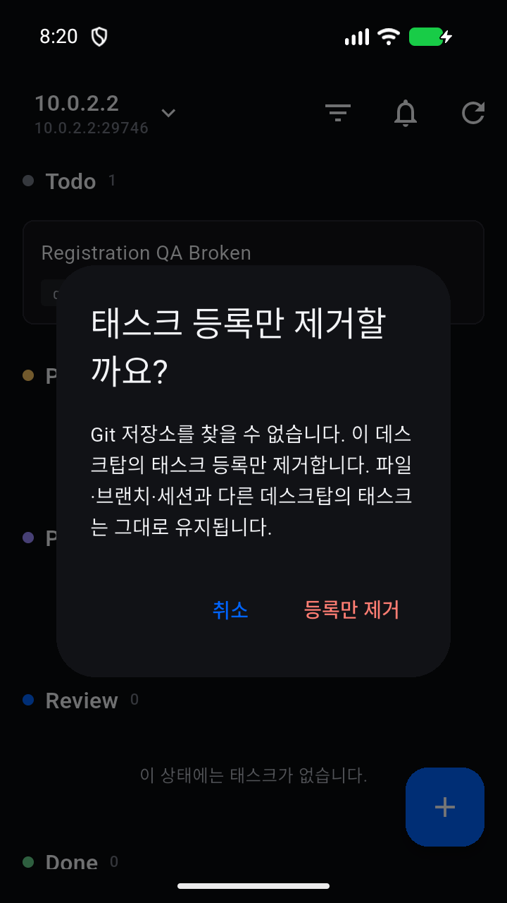
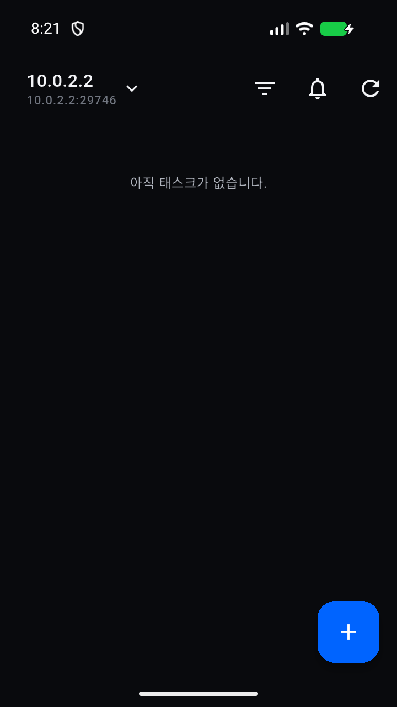

# 태스크 등록 제거 QA

PR https://github.com/rookedsysc/kanvibe/pull/431

커밋 `3888c38702f5d2400da5fcf9cd16e842e11ea446`에서 타입 검사와 데스크탑 빌드, 데스크탑 테스트 2,648개, Flutter 분석과 테스트 402개가 통과했습니다.

Android 영상과 스크린샷은 기준 커밋 `82fe04d2ba82de026fc8cefc0cdd801501d26b96` 위 기능 diff `69115e973274a00234f31d2f7396c83e2c587bb6`에서 촬영했습니다. 이후 `dev`를 갱신해 PR을 만들었습니다. 이 녹화는 갱신 전 기기 실행 결과이며 현재 PR 커밋에서는 데스크탑·Flutter 테스트를 재실행했습니다.

기기 흐름은 취소 후 카드 유지와 확인 후 카드 제거를 검증했습니다. 격리 DB의 등록이 제거됐고 worktree 사용자 파일과 Git 메타데이터가 보존됐습니다.

[Android 시연 영상](registration-only.mp4)
